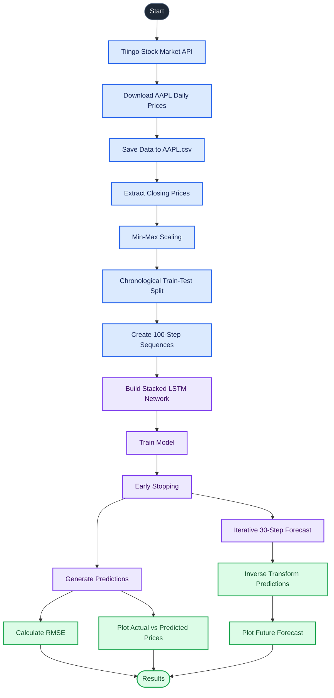
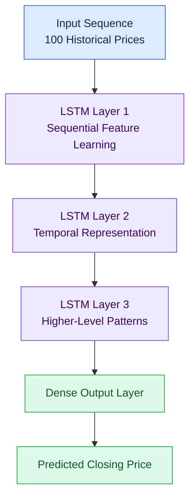

# 📈 Stock Price Prediction Using Stacked LSTM

<p align="center">
  
  
  
  
  
</p>

<p align="center">
  A deep learning project that uses a stacked Long Short-Term Memory (LSTM) neural network to analyze historical Apple (AAPL) stock prices and generate future price forecasts.
</p>

<p align="center">
  <b>Historical Data → Preprocessing → LSTM Training → Prediction → Forecast Visualization</b>
</p>

---

## 🧭 Table of Contents

- [Overview](#-overview)
- [Project Objectives](#-project-objectives)
- [System Architecture](#-system-architecture)
- [Model Architecture](#-model-architecture)
- [Key Features](#-key-features)
- [Tech Stack](#-tech-stack)
- [Project Structure](#-project-structure)
- [Getting Started](#-getting-started)
- [How It Works](#-how-it-works)
- [Evaluation](#-evaluation)
- [Limitations](#-limitations)
- [Future Improvements](#-future-improvements)
- [Disclaimer](#-disclaimer)

---

## 🔍 Overview

Stock markets are influenced by numerous factors, making price prediction a challenging time-series forecasting problem.

This project explores the use of **deep learning and stacked LSTM networks** to learn temporal patterns from historical Apple Inc. (AAPL) daily closing prices.

The pipeline retrieves historical stock data from the Tiingo API, preprocesses the closing-price series, trains an LSTM model on rolling windows of 100 observations, and generates predictions for the test dataset and the next 30 trading-day observations.

### 🎯 Project Objectives

- Retrieve historical stock prices using the Tiingo API.
- Preprocess and normalize time-series data.
- Build a stacked LSTM model for sequential pattern learning.
- Compare model predictions with historical closing prices.
- Evaluate prediction errors using Root Mean Squared Error (RMSE).
- Generate and visualize an iterative 30-step forecast.

---

## 🏗️ System Architecture

The following Mermaid diagram illustrates the complete workflow.



---

## 🧠 Model Architecture

The project uses a **three-layer stacked LSTM network** to learn temporal dependencies in historical stock prices.

Each input sequence contains the previous 100 observations, which the model uses to predict the next price.



**Core concepts**

- **LSTM:** A recurrent neural network architecture designed to learn relationships across sequential data.
- **Stacked layers:** Multiple LSTM layers process sequential representations to learn more complex temporal patterns.
- **Sliding window:** A sequence of 100 historical observations is used as the input for a prediction.
- **Early stopping:** Training stops when the monitored validation loss no longer improves sufficiently, helping reduce overfitting.

*Note: The diagram represents the conceptual model architecture. Consult `stock.py` for the exact layer configuration and parameters.*

---

## ✨ Key Features

| Feature | Description |
|---|---|
| 📡 Data collection | Retrieves daily AAPL stock data from Tiingo |
| 🧹 Preprocessing | Extracts closing prices and applies Min-Max scaling |
| 🪟 Sequence generation | Creates rolling windows of 100 observations |
| 🧠 Deep learning | Uses a three-layer stacked LSTM network |
| ⏹️ Early stopping | Monitors validation loss during training |
| 📊 Model evaluation | Calculates RMSE for predictions |
| 🔮 Future forecasting | Generates an iterative 30-observation forecast |
| 📈 Visualization | Plots historical prices, predictions, and forecasts |

---

## 🛠️ Tech Stack

| Technology | Purpose |
|---|---|
| Python | Core programming language |
| TensorFlow / Keras | LSTM model construction and training |
| NumPy | Numerical computations |
| Pandas | Data loading and manipulation |
| Requests | Tiingo API communication |
| Scikit-learn | Data normalization and preprocessing |
| Matplotlib | Prediction and forecast visualization |
| Tiingo API | Historical stock market data |

---

## 📂 Project Structure

```text
stock-market-prediction/
│
├── stock.py           # Data pipeline, model training and forecasting
├── requirements.txt   # Python dependencies
├── AAPL.csv           # Downloaded stock price data (generated)
└── README.md          # Project documentation
```

`AAPL.csv` is generated or overwritten when the script downloads data. It does not need to exist before the first successful run.

---

## 🚀 Getting Started

### 1. Clone the Repository

```bash
git clone https://github.com/Senior19/stock-market-prediction.git
cd stock-market-prediction
```

### 2. Create a Virtual Environment

**Windows PowerShell**

```powershell
python -m venv .venv
.\.venv\Scripts\Activate.ps1
```

**Linux / macOS**

```bash
python3 -m venv .venv
source .venv/bin/activate
```

### 3. Install Dependencies

```bash
python -m pip install --upgrade pip
pip install -r requirements.txt
```

### 4. Configure Your Tiingo API Key

Create an account with [Tiingo](https://www.tiingo.com/) and obtain an API token with access to the required daily price data.

**Windows PowerShell**

```powershell
$env:TIINGO_API_KEY = "your-tiingo-api-token"
```

**Linux / macOS**

```bash
export TIINGO_API_KEY="your-tiingo-api-token"
```

Keep your API key private. Never commit credentials to GitHub.

### 5. Run the Project

```bash
python stock.py
```

The script downloads the available AAPL historical data, saves it to `AAPL.csv`, trains the model, and generates prediction and forecast plots.

> **Tip:** Run the project in an environment that supports interactive Matplotlib windows. TensorFlow compatibility depends on your Python version and the versions listed in `requirements.txt`.

---

## ⚙️ How It Works

The pipeline consists of six main stages.

### Stage 1 — Data Collection

Historical daily Apple stock prices are retrieved from Tiingo, starting on January 1, 2010, and extending to the current date requested by the script.

### Stage 2 — Preprocessing

The closing-price series is extracted and normalized to the range 0–1 using Min-Max scaling. The observations are split chronologically into 65% training data and 35% test data.

### Stage 3 — Sequence Generation

A sliding window of 100 observations creates the input sequences used to predict the next price.

For example:

```text
Input:  [Price(t-99), ..., Price(t)]
Target: Price(t+1)
```

### Stage 4 — Model Training

The stacked LSTM network learns sequential patterns from the training data. Early stopping monitors validation loss to determine when to stop training.

### Stage 5 — Evaluation and Visualization

The trained model generates predictions for training and test sequences. The script calculates RMSE and plots predicted prices against actual prices.

### Stage 6 — Future Forecasting

The model generates a forecast for the next 30 observations. Each new prediction is fed back into the input window to generate the following prediction.


The forecast horizon represents **30 trading-day observations**, not 30 calendar days.

---

## 📏 Evaluation

The project uses Root Mean Squared Error (RMSE) to measure prediction error.

\[
\operatorname{RMSE} =
\sqrt{\frac{1}{n}\sum_{i=1}^{n}(y_i-\hat{y}_i)^2}
\]

Where:

- \(n\) is the number of evaluated observations.
- \(y_i\) is the actual closing price.
- \(\hat{y}_i\) is the predicted closing price.

Lower RMSE indicates smaller average squared prediction errors, but it does not establish that a model is profitable or that its forecasts will remain accurate in the future.

For meaningful evaluation, compare the model with a simple baseline, such as predicting that the next closing price will equal the latest observed closing price.

---

## ⚠️ Limitations

- **Limited features:** The model uses closing prices only, without volume, technical indicators, company fundamentals, or broader market information.
- **Non-stationary market:** Stock prices can change in response to news, economic conditions, and unexpected events.
- **Validation leakage risk:** The test segment is also used for early-stopping validation, so it is not a fully independent final test set.
- **Compounding forecast errors:** Iterative predictions can accumulate errors across the 30-step horizon.
- **No trading simulation:** The project does not establish profitability after transaction costs, slippage, or other real-world trading constraints.
- **Uncertain predictions:** Historical patterns do not guarantee future price movements.

---

## 🔭 Future Improvements

Potential extensions to improve the project include:

- [ ] Add trading volume, daily returns, and technical indicators.
- [ ] Use separate training, validation, and final test periods.
- [ ] Compare LSTM with GRU, ARIMA, and baseline forecasting models.
- [ ] Add walk-forward validation for more robust time-series evaluation.
- [ ] Evaluate directional accuracy alongside RMSE and MAE.
- [ ] Generate forecast intervals to communicate uncertainty.
- [ ] Build an interactive dashboard using Streamlit.
- [ ] Support multiple stock tickers through configurable inputs.
- [ ] Add experiment tracking and reproducible model configurations.

---

## 📌 Disclaimer

This project is intended for educational and research purposes only. It demonstrates a deep learning approach to time-series forecasting and is not financial advice.

Stock market predictions are inherently uncertain. The model's outputs should not be used as the sole basis for investment or trading decisions.

---

👨‍💻 Made By

<p align="center">
  <strong>Ashish Kumar Jha</strong><br/>
  AI/ML Engineer
  <br/><br/>
  <a href="https://github.com/Senior19">
    
  </a>
</p>

<p align="center">
  <i>Building intelligent solutions with AI, Machine Learning, and Deep Learning.</i>
</p>

<p align="center">
  ⭐ If you find this project useful, consider starring the repository!
</p>
